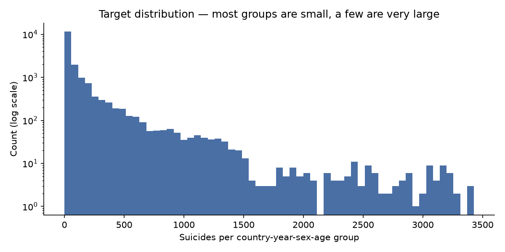
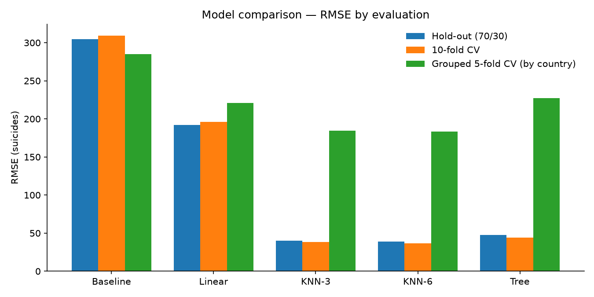
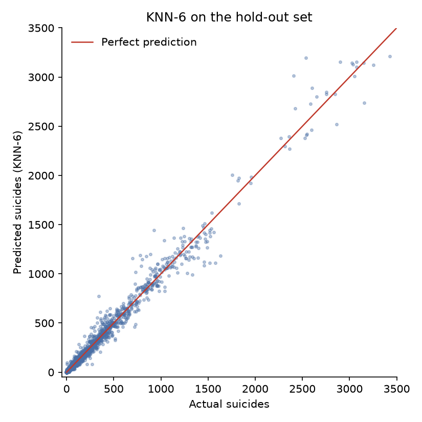

# Predicting Suicide Numbers

Predicting the number of suicides in a country, year, sex and age group, from the WHO-compiled Kaggle dataset "Suicide Rates Overview 1985 to 2016". Three regression models — multivariable linear regression, weighted k-nearest neighbours (k=3 and k=6) and a tuned regression tree — compared on a 70/30 hold-out split plus shuffled 3-, 5- and 10-fold cross-validation and a country-grouped cross-validation, scored on RMSE, against an explicit **baseline** (predict the mean).

## Data

`data/train.csv` (18,083 rows) and `data/test.csv` (9,737 rows) from the
competition; together they make up the 27,820-row Kaggle dataset. The
competition test set has no target column, so it is used only to generate a
submission file. Public data, included in the repo so the analysis runs
without a download.

Pre-processing: drop the HDI column (69% missing), drop
rows from 2016 (incomplete recording), drop Japan (male suicide counts of
3,000–8,000 heavily skewed the target). Features are age, sex, country and
population; the target is `suicides_no`. After cleaning: 17,591 rows, target
mean 126.2, median 19, standard deviation 309.7.



## Results

All numbers are computed in `notebooks/suicide-numbers-prediction.ipynb`
(pipeline in `src/modelling.py`) — none are hand-copied.

| Model | Hold-out RMSE (70/30) | 10-fold CV RMSE | Grouped 5-fold CV RMSE (by country) |
|---|---:|---:|---:|
| Baseline (predict the mean) | 304.59 | 309.13 | 284.81 |
| Linear regression | 192.28 | 195.94 | 220.67 |
| KNN-3 (weighted) | 40.04 | 38.13 | 184.54 |
| KNN-6 (weighted) | 38.74 | 36.53 | 183.36 |
| Decision tree (tuned: no max depth, min leaf 5) | 47.33 | 44.01 | 227.28 |



The 2021 figures are in [Background](#background-the-2021-version) below.

**What the numbers say:** KNN-6 is the best model on every split — hold-out
38.74, 10-fold CV 36.53, grouped 183.36 — with KNN-3 close behind (40.04 /
38.13 / 184.54). The tuned tree (no max depth, min leaf 5) is third on random
splits (47.33 / 44.01) but drops below linear regression on unseen countries
(227.28 vs 220.67). Linear regression is the weakest real model (192.28 /
195.94 / 220.67) and still far better than the baseline (304.59 / 309.13 /
284.81). Every model beats the baseline by a wide margin.



## How to read this

1. **The baseline matters.** Without it, models are only compared against
   each other. The mean predictor (RMSE ~309) shows how much of the error is
   just the target's spread, and every model here has to beat it to claim it
   learned anything.
2. **KNN works because the categories are one-hot encoded.** Converting them
   to integers would make nearest-neighbour distances meaningless across
   countries. Most of KNN's advantage on a random split is neighbouring rows
   from the same country in adjacent years, whose suicide counts barely
   change. Hold out whole countries instead, and KNN falls from 36.53 to
   183.36 — still the best model, but by a much smaller margin. The grouped
   CV is the honest number for "predict a country you have never seen"; the
   random-split numbers are the honest number for "fill in a missing year
   for a known country". Both are reported; neither is hidden.

## Conclusion

KNN-6 is the model to use. It is the best on every split: hold-out 38.74,
10-fold CV 36.53, grouped 183.36. The tree, tuned by cross-validated grid
search (no max depth, min leaf 5), is a credible second on random splits
but generalises worse to unseen countries than linear regression does.

The honest expectation depends on the question. For filling in a missing
year for a country already in the data, expect errors around 37 suicides.
For a country the model has never seen, expect around 183 — still the best
of the five models, but a much smaller lead. The grouped cross-validation
is the number to quote for generalisation; the random-split numbers are the
number for imputation.

The project is complete: the notebook runs end to end, every metric is
computed from the predictions, and a submission file is generated in the
competition's format.

## Background: the 2021 version

This analysis started as a 2021 Machine Learning assignment (R, Kaggle
InClass competition "Suicide Rates Prediction", Cyber Labs). The 2021
figures, for comparison: linear regression 239.08 (hold-out) / 242.63
(10-fold CV); KNN-3 268.85 / 254.85; KNN-6 241.17 / 241.95; decision tree
65.62 / 230.86. That version had no baseline, converted categories to
integers (which is why its KNN scored ~242 instead of ~37), and could not
submit to Kaggle (an unresolved error), so no leaderboard placement exists.
Its decision-tree hold-out figure (RMSE 65.62, R² 0.955) did not survive
its own cross-validation (230.86). Two small errors in the 2021 report are
corrected here: KNN-3's MSE was listed as 7,278.779 when 268.847² is about
72,279, and the stated maximum of 3,247 after removing Japan is 3,427 in
the data. Figures from the 2021 version are kept in
`assets/original-2021/` (correlation heatmap, LM1 residuals).

## Method

The pipeline lives in `src/modelling.py` (pre-processing, model
definitions, evaluation); the notebook
(`notebooks/suicide-numbers-prediction.ipynb`) calls it and presents the
results. The analysis: load, clean, build pipelines, tune the tree by grid
search, evaluate on a 70/30 hold-out plus shuffled 3/5/10-fold CV plus a
country-grouped 5-fold CV, and generate the submission file. Pre-processing
lives inside the pipelines, so nothing leaks across folds. Seed fixed (42)
throughout, so it reproduces.

```
.
├── README.md
├── data/                  # competition train.csv + test.csv
├── notebooks/             # the analysis notebook
├── src/                   # modelling.py — the pipeline
├── outputs/               # submission.csv
├── assets/                # figures (model comparison, target distribution,
│                          # predicted vs actual) + original-2021/
└── assets/original-2021/  # figures from the 2021 version
```

## Reproduce

```bash
pip install -r requirements.txt
jupyter nbconvert --to notebook --execute notebooks/suicide-numbers-prediction.ipynb
```

## A note on the topic

This is aggregate public-health statistics — counts by country, year, sex and
age group. The model predicts counts for planning purposes, never individuals,
and no individual-level data is involved.

## Licence

MIT. See [LICENSE](LICENSE).
